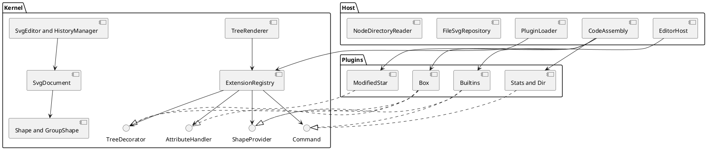
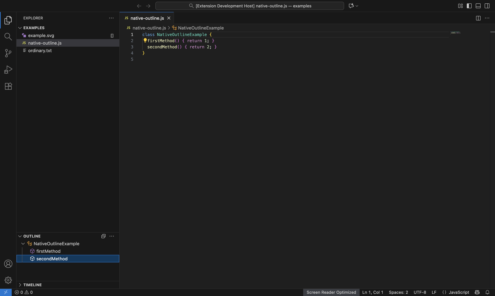
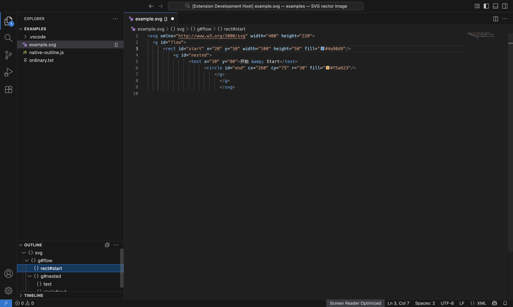
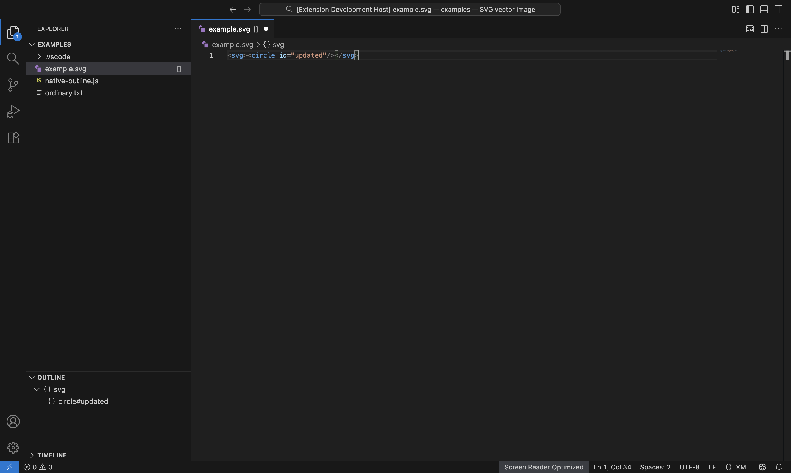
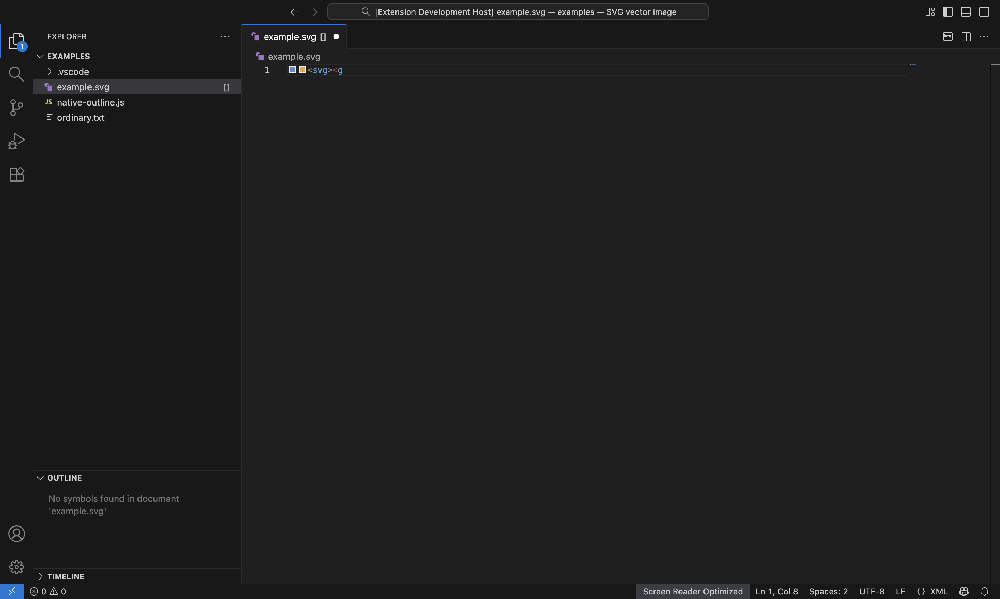

# Lab2：SVG 插件框架、小组实践与 DSH 工作台

代码仓库：<https://github.com/Isaaaaaaaaaaaaaa/phase_cli_1>

本项目完成 `phase_cli_2-研-1.md` 的三部分：VSCode 文件标记与原生大纲、Phase 1 CLI 的插件式重构、DeepSeek Harness SVG 工作台插件。Phase 1 基线保留在 `final`；Phase 2 在独立 `lab2` 分支开发，最终交付为 `p2`。旧目录中的未提交改动未参与本次重构。

## 1. 安装与运行

使用 Node.js 24.9 或以上版本。本地实测 Node 24.10.0。各包的公共 npm 锁文件随仓库提交。

```bash
npm ci
npm run cli
# 默认代码装配：六种基础图形、原有命令、stats、dir、box、两种标签

npm run cli -- --config plugins.config.json
# 配置装配，使用同一注册校验路径

npm run cli -- --no-plugins
# 仅默认内置能力，用于 Phase 1 兼容性验收

npm run check
node scripts/verify-assembly.mjs
node scripts/verify-ocp.mjs
```

CLI 提示符保持 `svg>`，注释行以 `#` 开头。输入、预期输出和 SVG 文件分别放在 `doc/transcript/`，不把示例输出混入输入脚本。

VSCode 安装/开发见 [扩展说明](../extensions/vscode-svg/README.md)，DSH 安装/开发见 [插件说明](../integrations/dsh-svg/README.md)。小组分工见 [team.md](team.md)。

## 2. 架构方案

### 2.1 实际模块划分

| 模块 | 实际目录 | 职责 |
| --- | --- | --- |
| 公开 API | `src/api.ts` | 插件可用的领域抽象、扩展接口和宿主端口 |
| 领域内核 | `src/domain/` | 封装图形、文档树、全局 ID、组合操作；ShapeFactory 消费注册表 |
| 应用内核 | `src/application/` | 会话、Command 快照事务、undo/redo、查询渲染、I/O 接口 |
| 扩展契约 | `src/extensions/` | 四个扩展点、注册存储、属性路由、标签组合及事件 |
| 宿主与适配器 | `src/host/`、`src/cli/`、`src/infrastructure/` | 组合根、模块加载、REPL、真实目录与 SVG 文件读写 |
| 默认插件 | `src/plugins/builtin-shapes/`、`builtin-commands/` | 六种类型的 provider 和 Phase 1 全部命令，通过注册装配 |
| 可选插件 | `src/plugins/stats/`、`dir/`、`shape-box/`、`modified-star/` | 独立命令、复合类型、属性领域语义、树标签 |
| VSCode 扩展 | `extensions/vscode-svg/` | 文件装饰与保留源范围的 XML 大纲 |
| DSH 集成 | `integrations/dsh-svg/` | 真实 Cordis/DSH SDK 适配、会话隔离、批次事务、受限文件访问 |
| 验证与指标 | `tests/`、`scripts/`、`docs/metrics/` | 回归、独立插件测试、历史差异与 AST 指标 |

实际目录保留 `domain/application` 这两个 Phase 1 名称，减少迁移噪声；没有采用方案草案中的 `src/kernel/` 外层目录。内核范围由公开 API、domain、application 和 extensions 明确界定，指标脚本采用同一边界。

### 2.2 重构前后依赖图

浏览器可直接查看 [重构前图](../docs/images/architecture-before.svg) 和 [重构后图](../docs/images/architecture-after.svg)；对应 `.puml` 源码与文档一并提交。

重构前 Factory 直接枚举具体类型和命令：

```plantuml
@startuml
package "CLI" { [CommandFactory] }
package "Application" {
  [Concrete Commands]
  [HistoryManager]
}
package "Domain" {
  [ShapeFactory]
  [SvgDocument]
  [Six Shapes]
}
package "Infrastructure" { [FileSvgRepository] }
[CommandFactory] --> [Concrete Commands]
[CommandFactory] --> [ShapeFactory]
[Concrete Commands] --> [SvgDocument]
[ShapeFactory] --> [Six Shapes]
[SvgDocument] --> [Six Shapes] : container operations
[FileSvgRepository] --> [ShapeFactory]
@enduml
```

重构后，类型、命令、属性和标签实现均在插件侧：



依赖规则：内核不导入具体插件、Node fs、VSCode 或 DSH；CLI 插件仅从 `src/api.ts` 获取内核能力，不访问内核私有文件或宿主装配；加载器不导入任何具体插件，不包含插件名字映射；真实 I/O 实现位于宿主。VSCode 不依赖 CLI 模型；DSH 使用公开编辑器门面，在发布包中打包这些能力。

`GroupShape` 是公开的组合容器基类，`g` 的 ShapeProvider 仍由默认插件注册。Box 继承容器操作并覆写必要部件保护、clone、语义类型及创建反馈；内核不识别 box 名字。

外部集成使用 `src/host/api.ts` 的宿主公开门面；它与 `src/api.ts` 的内核插件接口分开。CLI 插件不依赖宿主门面，DSH 集成则复用完整的默认编辑器及装配能力。

### 2.3 设计模式

- **Command**：编辑对象实现 `EditorCommand`/`ReversibleCommand`；`SnapshotCommand` 让一次命令成为一个原子事务及 undo 单元。失败不提交历史或清空 redo。
- **Composite**：叶子与容器统一使用 Shape 的 move/scale/set/clone；嵌套容器递归传播几何操作。
- **Adapter**：DirCommand 面向 DirectoryReader；NodeDirectoryReader 转换 Node fs Dirent。FileSvgRepository 将 XML DOM 与领域模型对接。
- **Decorator**：TreeRenderer 保持基线渲染，ExtensionRegistry 按注册顺序组合 TreeDecorator 的行尾标签。各标签互不导入，不共享状态。
- **OCP**：box 及 modified-star 的接入提交没有修改内核、渲染器或既有插件；命令插件只在组合根和配置中选择。

## 3. 扩展点清单

下列位置均对应仓库实际文件和函数，不以伪代码代替交付。

| 接口 | 职责 | 内核调用位置 | 已有实现 | 禁用可选实现时 | 契约错误处理 |
| --- | --- | --- | --- | --- | --- |
| ShapeProvider | 类型名、创建参数、SVG 匹配及读回 | `src/domain/ShapeFactory.ts::create/fromSvg`，由 `CreateCommand.perform` 与 `FileSvgRepository.readShape` 调用 | 六个 BuiltinShapeProvider 实例、BoxProvider | 六种默认类型可用；create box 报 unknown shape type；带 data-kind 的 g 降级 | 重复注册拒绝；创建/读回 ID 与请求不一致报 invalid shape provider result；新增子树 ID 冲突整体失败 |
| Command | 命令名、usage、section、参数校验及命令对象 | `src/cli/CommandFactory.ts::fromLine`；`SvgEditor.execute` 执行类别语义 | CommandDefinition 的内置实例；StatsCommand；DirCommand | help 没有 stats/dir；执行时报 unknown command | 重复名称拒绝；插件自行报 usage；必需 create 方法缺失报 invalid registration contract |
| TreeDecorator | 行尾标签及保存/历史事件观察 | `TreeRenderer.render/renderChildren` → `ExtensionRegistry.decorate`；`SvgEditor.execute` → `observe` | ModifiedStar、BoxTypeLabel | tree 基线逐字节不变 | 非字符串标签报 invalid decorator result；标签接收模型副本；观察器抛错被隔离并输出独立诊断 |
| AttributeHandler | 判断负责的图形/属性并执行领域修改 | `SetCommand.perform` → `ExtensionRegistry.setAttribute` | BoxAttributes | 沿用 Phase 1 白名单；rect 的 label 报 unknown attribute | 多个命中拒绝；handles 修改状态或返回非布尔报契约错误；apply 失败或非法返回值由快照事务回滚，不能转默认分支 |

插件为类或类实例。注册名在每个类别内唯一；不同类别可以使用不同语义名称。注册上下文只开放四个 register 方法；内部 Map 仍是私有字段。

## 4. 两种装配方式与配置

方式 A 的选择代码集中在 `src/host/CodeAssembly.ts::install`。EditorHost 默认装配六种类型和原有命令，可选插件仍通过 `PluginLoader.install` 校验。

方式 B：

```json
{
  "plugins": [
    { "module": "./src/plugins/stats" },
    { "module": "./src/plugins/dir" },
    { "module": "./src/plugins/shape-box", "options": { "fill": "#4a90d9" } },
    { "module": "./src/plugins/modified-star" }
  ]
}
```

模块相对路径以配置文件目录为基准，包名使用 `createRequire(...).resolve` 的标准规则；随后动态 import 已解析入口。当前仓库各插件 package.json 的 main 指向编译产物，所以应先 build。配置按数组顺序加载，enabled=false 完全跳过，options 传给同一个类实例的 activate。

每个插件 package.json 的 contributes 声明四类名称列表，未写类别为空。激活采用暂存注册 → 清单集合校验 → 全部合并；拒绝当前插件不影响之前成功的插件。

加载器支持规定的四类恢复错误：plugin not found、plugin has no default export、plugin manifest mismatch、plugin failed to activate。重复注册单独报 `error: duplicate registration: <category>/<name>`。无效 JSON 或结构报 `error: invalid plugin config`，保留默认内置能力启动。入口存在但其依赖缺失属于 failed to activate，不能误报 not found。

CLI activate 契约为同步；异步激活被明确拒绝，捕获其 Promise 拒绝，避免后台注册或未处理异常。DSH 的 apply 属于外部宿主自己的契约，与本 CLI 加载器无关。

## 5. 独立插件行为

### 5.1 stats 与 dir

stats 从文档子节点深度优先遍历，类型顺序按首次出现；g/box 只计入 containers，box 内叶子照常计入 total，SVG 根不计入。空文档输出 `(total 0, containers 0)`。

dir 无参数，无需 init/read，不改变文档、dirty、当前目录或历史。目录前、文件后，按名称的确定性字符串顺序排序；隐藏项保留，不列出 `.`/`..`。链接为 `[LINK]`，特殊项为 `[OTHER]`，放在普通文件之后且不跟随目标。空目录和读取失败分别输出规定信息，失败后 REPL 继续。

适配器角色：DirectoryReader 是 Target；Node fs readdirSync/Dirent 是 Adaptee；NodeDirectoryReader 是 Adapter；DirCommand 是 Client。测试使用 DirectoryStub 独立验证逻辑，再用真实临时目录验证组合；同一固定目录的两种装配输出逐字节一致。

### 5.2 box 与属性处理

```text
create box n1 120 100 160 60 "开始"
set n1 fill #f5a623
set n1 label "处理数据 v2"
undo
redo
```

BoxProvider 通过公开图形工厂创建 `<id>-rect` 与 `<id>-label`。BoxShape 是容器，支持 in、整体 move/scale、嵌套以及删除整体；ungroup 和普通命令脱离必要部件会被拒绝。

fill 修改内部矩形，label 修改内部文本，均由独立 AttributeHandler 路由。一次 set 即使修改多个节点也只有一个 undo 单元。未命中处理器时仍按原白名单处理。

保存为普通 SVG g + `data-kind="box"`。已加载 box 时严格检查必要部件；未加载时恢复为普通 g。重复 ID 拒绝整个读入；非法 box 也拒绝并保留旧文档。

### 5.3 树标签

ModifiedStar 比较当前内容与保存基线；新节点立即标 `*`，子节点改变向祖先及 SVG 根传播，undo 回到保存点后消失。保存失败不更新基线，canvas 尺寸变化也标记根。

实例私有字段保存基线，无模块级可变状态。BoxTypeLabel 与 ModifiedStar 互不感知，按注册顺序组合为 `(box) *`。

## 6. VSCode 实践与真实证据

VSCode 管理 Explorer、Outline、编辑事件、UI 刷新和源码导航；插件注册 FileDecorationProvider/DocumentSymbolProvider，宿主在需要展示文件或符号时调用 provider。

FileDecorationProvider 对 SVG 文件返回 `[]`，用 workspace.fs.stat 排除目录，不改文件名/内容，不向目录传播。DocumentSymbolProvider 使用 saxes 严格解析 XML，保留源偏移并转为 range/selectionRange，返回根、容器、叶子和无 ID 节点。编辑不完整时返回空数组，修复后恢复。

原生 Outline 观察记录：JavaScript 示例中，类 NativeOutlineExample 下有两个 method；大纲保留层级，并由宿主负责导航。由此校验 SVG 也应返回嵌套 DocumentSymbol，而不是仅返回扁平 SymbolInformation。

本组真实 Extension Development Host 证据（VSCode 1.105.1）：







`npm run test:host` 在真实 Extension Host 内验证嵌套、无 ID、定位范围、编辑更新、不完整 XML、文件/目录区别。`scripts/verify-ui.py` 连接真实 VSCode Chromium 工作台，再次验证点击第 6 行/第 3 行、更新与恢复并保存截图；截图来自运行中的扩展。

样例工作区设置 `.svg` 使用 Text Editor，避免默认图片预览绕过文本大纲。安装扩展后也可右键 SVG → Open With → Text Editor。

**模式区别**：VSCode “文件装饰”是 provider 回调提供 UI 元数据，并不要求包装另一个同接口对象，因此不能直接等同于经典 Decorator 的对象包裹结构。Provider 把插件判断转换为宿主 FileDecoration/DocumentSymbol，具有适配器作用；CLI TreeDecorator 更直接地组合渲染行为。两者都依赖接口及对象组合，UI 所有权仍在宿主。

**复用评估**：Phase 1 Shape/Composite/Command 和遍历语义适合 CLI 与 DSH；旧 SVG 文件读取器受六种类型约束且不保留源码范围，不直接用于只读 Outline。VSCode 的源文本模型可以面对任意 XML 元素而不要求编辑器图形类型。

## 7. DSH SVG 工作台

源码位于 `integrations/dsh-svg/`。使用真实 `@deepseek-ai/cordis` 4.1.0 和 `@deepseek-ai/dsh-tools` 0.2.2-rc.3，以 apply/context.tools.register/defineTool 接入。提供 output schema 与 render，卸载时注册由 Cordis 生命周期撤回。

| 工具 | 行为 |
| --- | --- |
| svg_inspect | 读取工作区内 SVG，返回层级和 ID，不写文件或替换编辑会话 |
| svg_edit | 原子执行至多 100 条编辑命令；失败丢弃整个候选文档 |
| svg_history | 一次 undo/redo 恢复一整个成功工具批次 |
| svg_save | 唯一文件写入入口，保存指定工作区内的 SVG |

状态按宿主 agent 对象在实例 WeakMap 中隔离；不同智能体不共享当前文档或历史。文件路径检查真实目录及符号链接，拒绝逃逸、非 SVG 和超过 2 MiB 的输入；调用检查取消信号，不把路径拼入 shell。

已验证真实 Cordis + DSH ToolsService 的加载、参数 schema 验证、工具调用、SVG 保存/检查及卸载，同时测试会话隔离、批次失败回滚与路径边界。测试中的 SystemPrompt Fixture 只替代未参与调用的提示装配服务；工具注册/defineTool/生命周期均来自真实 SDK。模型发起调用的演示需要宿主自己的模型凭据，本项目不包含凭据。

打包命令 `npm pack` 生成可安装 tgz，内部包含编辑器与插件代码，不依赖运行时存在课程源码目录。插件市场发布为实验建议项，未声称已经发布。

干净安装检查发现 pnpm 不一定自动安装 SDK peer，导致最初的外置 SDK 包无法直接导入。最终包把需要的 SDK 运行代码一起打包，继续通过宿主实际的 ctx.tools 注册；用 engines.dsh 锁定已验证宿主版本，不依赖安装器的 peer 自动安装策略。

## 8. ADR 与变化点

完整 ADR：

1. [属性处理契约与事务](adr/001-attributes.md)
2. [box 不变量与读回降级](adr/002-box-roundtrip.md)
3. [dirty、祖先传播与标签顺序](adr/003-dirty.md)
4. [清单校验与加载事务](adr/004-loading.md)
5. [目录访问适配器](adr/005-directory.md)

未来图形、命令、属性和标签通过扩展接口增长；I/O 更换通过端口替换。没有为 GUI 鼠标编辑、插件热卸载或任意 SVG 全规范编辑提前搭建复杂基础设施；本实验以静态启动装配和受支持图形子集为边界。快照事务优先保证正确性，内存/时间代价随文档规模增长，大文档可在保持 Command 契约的前提下改为差量历史。

## 9. 过程记录和一致性自查

| 节点 | 提交/证据 |
| --- | --- |
| VSCode 扩展源码 | `32d2fa6`，后续真实宿主截图与工作区打开方式修订 |
| 框架可扩展 | `6a85031`，四接口、注册事务、基线逐字节兼容 |
| 命令插件完成 | `dfc3120`，stats/dir、适配器、独立测试、首次自动指标 |
| box 代码装配 | `e0514f3`，只改一个组合根；内核与既有插件差异为空 |
| box 配置装配 | `941145a`，分支 `lab2-box-config-demo`，只新增插件包并改配置 |
| 标签完成 | `a70d30d`，新增 ModifiedStar，内核与渲染器未改 |
| 收尾 | DSH、通用契约健壮性、文档、脚本与最终指标，最终标签 p2 |

检查并修正 AI 建议的实际记录：

- 按实验要求保留同一远程和 final；采用独立 worktree，避免覆盖旧目录未提交内容。
- 将仅返回标签名的 XML 大纲方案修正为带嵌套 children 与源码范围的 DocumentSymbol；真实宿主和 UI 验证定位。
- 为用户打开 SVG 时可能进入图片预览补充 Text Editor 工作区设置。
- 将无参数 ShapeFactory 的测试装配迁移到默认 EditorHost，保持原断言不变；额外运行真实 final 字节对比。
- 发现基础 npm 锁文件出现新的 minimatch 公告，更新兼容工具版本并对 typescript-estree 单独使用修复版本，完整 lint 和审计复验。
- DSH SDK 的 latest 标签与宿主不一致，没有盲目复制旧示例的 peer 范围；锁定实际测试的 SDK。
- 修正 DSH 输出类型为可满足 lossless JSON 的对象类型，并适配 macOS realpath 的 `/private` 规范化。
- 远程 Linux CI 发现 Mac 上生成的锁文件遗漏 WASI 所需的两个 emnapi 包；在没有 node_modules 的隔离环境，用 CI 的 npm 11.19.1 补全锁记录。所有已有包版本保持不变，干净 npm ci、36 个测试和审计再次通过。
- 实际 UI 自动化发现异步输入/自动补括号影响复验，改为先清空并验证缓冲区，再输入；成功后恢复示例内容。

模块自查：实际目录与上文一致，方案草案外层 kernel 目录未使用的差异已明确记录。依赖自查：插件只导入公开 API；内核不导入具体插件；加载器没有名字映射。新增 box/标签的历史差异由脚本验证，不能只凭空搜索结果认定合规。

观察器异常隔离属于后续通用健壮性修订：成功的编辑仍保留其成功反馈和历史，异常标签被停用并输出独立插件诊断；失败的编辑/属性事务则整体回滚。此修订独立落库，不藏在插件接入证明提交里。

## 10. 质量保证与复现

- `npm run check`：strict TypeScript、typed ESLint、Vitest V8 四项覆盖率 ≥80%。
- `tests/cli.test.ts/domain.test.ts/repository.test.ts`：Phase 1 原有断言保留。
- `tests/loading.test.ts/contracts.test.ts`：四条加载失败路径、重复/回滚、配置结构、依赖求值失败、handles 纯查询及观察器隔离。
- `tests/command-plugins.test.ts`：stats/dir 独立逻辑、真实目录、失败后继续、文档/历史不变及两装配一致。
- `tests/box.test.ts`：独立上下文替身、派生 ID、部件保护、属性事务、嵌套、读回/降级。
- `tests/decorators.test.ts`：保存、再编辑、undo 回保存点、祖先传播、标签顺序和尺寸变化。
- VSCode：真实 Extension Host 测试与 UI 截图脚本。
- DSH：真实 SDK 注册/卸载和独立工作台测试。

基线复验：把 `final` 导出到独立目录、安装依赖并 build，再运行 `node scripts/verify-baseline.mjs <该目录>`。代码/配置一致性由 `verify-assembly.mjs` 对 cli-1、box、plugins 三组会话逐字节比较。dir 在固定临时目录运行，日志写在该目录之外。

OCP 证据由 `node scripts/verify-ocp.mjs` 生成 [ocp-verification.json](../docs/metrics/ocp-verification.json)，先确认目录在两个提交中存在，再排除新增插件比较内核/既有插件差异。

指标由 `node scripts/metrics.mjs p2` 从 Git 历史生成：[指标说明](../docs/metrics/README.md)、[原始清单](../docs/metrics/metrics.json)。物理行数和 AST 函数圈复杂度按内核/装配处/插件拆分，VSCode 单列，不计入 CLI 增量；测试、依赖和构建产物排除。指标不是手填。

本地实际验证：CLI 36 个测试通过；V8 语句 94.84%、分支 81.33%、函数 97.28%、行 95.59%；DSH 独立测试 3 个通过；真实 VSCode Extension Host 与 UI 复验通过；公共 npm 审计为 0 漏洞。构建入口的 `svg-editor 0.1` 提示保持基线不变，包版本为 0.2.0。

已完成的验证以实际生成的 transcript、测试输出和图像为准；小组人员的实际互审/贡献由成员另行确认，不虚构六个人的讨论或提交身份。

## 11. 接口资料来源

- [实验要求](https://github.com/Isaaaaaaaaaaaaaa/phase_cli_1)：本地 `phase_cli_2-研-1.md` 是验收的首要依据。
- [VSCode 官方 API](https://code.visualstudio.com/api/references/vscode-api)：FileDecorationProvider、DocumentSymbolProvider、range/selectionRange，使用 Context7 核对后实现。
- [saxes](https://github.com/lddubeau/saxes)：严格 XML 事件解析，实际源码偏移由测试验证。
- [DSH 官方仓库](https://github.com/deepseek-ai/deepseek-harness)：真实 SDK 为 0.2.2-rc.3。
- [DSH 插件教程](https://github.com/deepseek-ai/deepseek-harness/blob/master/docs/cordis-tutorial/01-first-plugin.zh.md)：Cordis 上下文、apply 和生命周期。
- [Kroki](https://kroki.io)：用提交的 PlantUML 源码生成架构 SVG，渲染结果经过 XML 格式检查。
