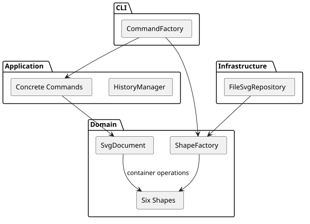
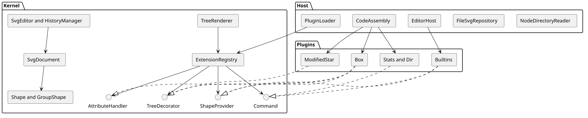

# Lab1 Phase 2：插件实践与插件式重构

本项目实现 VSCode SVG 文件标记与大纲、SVG CLI 插件框架及 DSH SVG 工作台。Phase 1 基线为 `final`，基线仓库为 <https://github.com/Isaaaaaaaaaaaaaa/phase_cli_1>。

## 1. 模块与依赖

| 模块 | 目录 | 职责 |
| --- | --- | --- |
| 公开 API | `src/api.ts` | 插件使用的领域对象、扩展接口和 I/O 端口 |
| 领域内核 | `src/domain/` | 图形封装、组合结构、ID 唯一性、文档操作 |
| 应用内核 | `src/application/` | 会话、命令快照、undo/redo、渲染及端口 |
| 扩展契约 | `src/extensions/` | 类型、命令、属性和标签接口，注册与路由 |
| 宿主 | `src/host/`、`src/cli/`、`src/infrastructure/` | 装配、配置加载、REPL、文件系统适配 |
| 内置插件 | `src/plugins/builtin-shapes/`、`builtin-commands/` | 六种图形与 Phase 1 命令 |
| 可选插件 | `src/plugins/stats/`、`dir/`、`shape-box/`、`modified-star/` | 统计、目录、复合图形、领域属性与标签 |
| VSCode 扩展 | `extensions/vscode-svg/` | 文件装饰、XML 源范围和原生大纲 |
| DSH 集成 | `integrations/dsh-svg/` | 工具注册、agent 状态、批次事务 |

依赖方向为宿主 → 插件/内核、插件 → 公开 API、应用内核 → 领域内核。Node 文件系统、VSCode 和 DSH SDK 位于适配边界。CommandToken 定义在内核接口，CLI tokenizer 消费该类型。`src/host/api.ts` 为 DSH 提供完整编辑器的装配入口。

### 重构前



[PlantUML 源码](architecture-before.puml)。Phase 1 的 CommandFactory 和 ShapeFactory 直接导入具体实现，追加类型或命令会修改 Factory。

### 重构后



[PlantUML 源码](architecture-after.puml)。Factory 消费扩展注册表；默认类型和命令也通过插件注册。BoxShape 继承公开 GroupShape，复用容器操作并定义必要部件约束。

## 2. 设计模式

| 模式 | 代码落点 | 作用 |
| --- | --- | --- |
| Command | EditorCommand、SnapshotCommand、HistoryManager | 将编辑封装为一次执行与撤销重做单元 |
| Composite | Shape、GroupShape、BoxShape | 统一叶子和容器的移动、缩放、克隆与删除 |
| Adapter | DirectoryReader、NodeDirectoryReader、FileSvgRepository | 把文件系统及 XML 接入领域接口 |
| Decorator | TreeDecorator、ModifiedStar、BoxTypeLabel | 组合树每行的展示标签 |
| OCP | 四扩展点、CodeAssembly、PluginLoader | 新实现通过注册接入，稳定内核消费接口 |

## 3. 扩展点清单

| 接口 | 职责 | 调用位置 | 实现 | 缺省行为 | 契约错误 |
| --- | --- | --- | --- | --- | --- |
| ShapeProvider | 参数、创建、SVG 匹配与读回 | `ShapeFactory.ts::create/fromSvg`；CreateCommand 和 FileSvgRepository 调用工厂 | 六个 BuiltinShapeProvider、BoxProvider | 六种基础类型可用；box 未注册时报 unknown shape type，读入带标记的 g 按普通分组恢复 | 重复注册拒绝；错误对象或 ID 报 invalid shape provider result；子树 ID 冲突整条创建失败 |
| Command | 名称、usage、section、参数与命令对象 | `CommandFactory.ts::fromLine`；`SvgEditor.ts::execute` | CommandDefinition、StatsCommand、DirCommand | help 展示已注册命令；未加载命令报 unknown command | 缺 create 报 invalid registration contract；重复名报 duplicate registration；参数由实现校验 |
| TreeDecorator | 标签与编辑/保存/历史事件 | `TreeRenderer.ts::render/renderChildren` → `ExtensionRegistry.ts::decorate`；SvgEditor 调用 observe | ModifiedStar、BoxTypeLabel | 无标签时保留 Phase 1 tree 输出 | 非字符串标签报 invalid decorator result；observe 异常报 decorator observer disabled 并停用实例 |
| AttributeHandler | 纯查询匹配与领域属性修改 | `SetCommand.ts::perform` → `ExtensionRegistry.ts::setAttribute` | BoxAttributes | 无命中时使用原属性白名单 | 多命中报 conflicting attribute handlers；handles 修改内容/画布报契约错误；apply 失败整体回滚 |

接口在 `src/extensions/`；调用方使用接口与公开领域对象。插件为类或类实例，状态封装在实例字段中。

## 4. 两种装配与加载契约

代码装配集中在 `src/host/CodeAssembly.ts::install`；配置装配读取根目录 `plugins.config.json`。两种方式共同进入 `PluginLoader.install`：

```text
创建插件 → 暂存注册 → activate → contributes 集合校验 → 合并注册
```

package.json 的 contributes 支持 shapes、commands、decorators、attributes 四类名称列表，缺省为空；按名称集合比较。注册名在同一类别内唯一。当前插件失败时撤销全部暂存注册，继续加载下一项。

```json
{
  "plugins": [
    { "module": "./src/plugins/stats" },
    { "module": "./src/plugins/dir" },
    { "module": "./src/plugins/shape-box", "options": { "fill": "#4a90d9" } },
    { "module": "./src/plugins/modified-star", "enabled": true }
  ]
}
```

加载顺序为数组顺序。相对模块路径以配置文件目录为基准，包名使用标准模块解析；options 传入 activate，插件负责校验。enabled=false 跳过该项。CLI 的 activate 为同步接口。

| 失败 | 输出 |
| --- | --- |
| 顶层模块无法解析 | `error: plugin not found: <module>` |
| 缺默认导出 | `error: plugin has no default export: <module>` |
| 声明与注册集合不一致 | `error: plugin manifest mismatch: <name> (declared: …, registered: …)` |
| 激活、模块求值或依赖加载失败 | `error: plugin failed to activate: <name> (<reason>)` |
| 重复注册 | `error: duplicate registration: <category>/<name>` |
| 配置 JSON 或结构无效 | `error: invalid plugin config` |

EditorHost 默认提供六种类型和原有命令。加载失败后 REPL 继续运行。

## 5. stats、dir 与目录适配器

stats 按当前子节点顺序深度优先遍历，叶子类型按首次出现顺序输出。普通 g 和 box 计入 containers，box 内部叶子计入 total，SVG 根排除。

```text
rect: 2  text: 2  circle: 1  (total 5, containers 2)
```

dir 查询进程启动目录的直接子项。目录、文件、链接、特殊项依次排列，各组按确定性的字符串比较升序；显示标记分别为 DIR、FILE、LINK、OTHER。隐藏项保留，链接按目录项展示。

Adapter 角色：DirCommand 是 Client；DirectoryReader 是 Target；Node 的 readdirSync/Dirent 是 Adaptee；NodeDirectoryReader 是 Adapter。

dir 属于 query，无需 SVG 文档，保留文档、dirty、工作目录和历史。空目录输出 `(empty directory)`，读取失败报 `error: cannot read directory: <path>`。stats、dir 的名称和 help 文案由各自插件提供。

## 6. 属性事务与 box

AttributeHandler 接收公开 Shape 和 SvgDocument，handles 判断类型及属性，apply 调用公开方法修改对象。多个处理器同时命中时拒绝并列出名称；无命中时执行 Shape 的原白名单。

SetCommand 使用完整快照：保存 before → 执行处理器 → 保存 after → 加入历史。一次 set 修改多个子部件仍为一个 undo 单元。失败恢复 before，原 undo/redo 历史保留。handles 的纯查询检查包含画布尺寸、属性、文本和结构。

box 包含 `<id>-rect` 和 `<id>-label`，创建整棵子树前校验 ID。fill 修改内部矩形，label 修改内部文本；支持 in、整体 move/scale、嵌套和整树删除。脱离必要子部件及 ungroup 通过容器保护契约拒绝。

序列化为 `<g data-kind="box">`。BoxProvider 优先匹配该标记；未加载时通用 g provider 接手。已加载时缺部件或类型错误拒绝整个 read，重复 ID 始终拒绝。

## 7. 树标签与 dirty

ModifiedStar 比较内容与保存基线。init/read/save 成功建立基线，新建节点标星，子节点修改传播到祖先及根；undo 回保存点后星号消失，redo 后重现。保存失败保留基线，canvas 尺寸修改标记根。

保存指纹封装在 ModifiedStar 私有字段。BoxTypeLabel 根据公开类型返回 `(box)`。标签按注册顺序拼接为 `(box) *`，两个实现独立维护自己的行为。

## 8. VSCode 插件实践

VSCode 管理 Explorer、Outline、编辑通知和源码导航；插件向 `window.registerFileDecorationProvider`、`languages.registerDocumentSymbolProvider` 注册对象，宿主在展示文件及符号时调用 provider。

SvgFileDecorationProvider 使用 workspace.fs.stat 确认文件类型，返回 `FileDecoration("[]")`。SvgDocumentSymbolProvider 使用 saxes 解析 XML，按源偏移创建 DocumentSymbol 的 range/selectionRange 和 children，名称为 `标签名#id` 或标签名。编辑使用最新文本重算；不完整 XML 返回空大纲。

先观察 JavaScript 原生 Outline：类节点下嵌套 method，点击 method 定位源码。SVG 按同样的层次模型提供 DocumentSymbol。


安装与启动见 [扩展 README](../extensions/vscode-svg/README.md)。真实 VSCode 1.105.1 宿主测试覆盖嵌套分组、无 ID、源范围、更新、异常恢复及文件/目录标记。

### 模式对应与复用分析

经典 Decorator 通过包装同接口实例增加行为；VSCode 文件装饰通过 provider 返回展示元数据，由宿主组合到界面。两者均通过接口和对象组合扩展行为，调用链分别为包装对象调用组件、宿主调用 provider。

Provider 把文件/文本判断转为 FileDecoration 和 DocumentSymbol，承担 Adapter 角色。CLI 的 TreeDecorator 则直接组合渲染标签。

Phase 1 的 Shape、组合树、遍历及 Command 事务可以复用于 CLI/DSH。旧 FileSvgRepository 面向可编辑图形且缺少源范围；Outline 需要通用 XML 节点与源码定位，因此采用独立源文本模型。

## 9. DSH SVG 工作台

插件使用 Cordis 4.1.0 和 DSH ToolsService 0.2.2-rc.3，通过 apply(ctx)、inject 和 ctx.tools.register 接入，defineTool 声明参数、output.schema、output.render 与 execute。

插件把 SVG 编辑能力开放给智能体：svg_inspect 读取结构，svg_edit 执行原子批次，svg_history 撤销重做，svg_save 保存文件。状态按 agent 对象封装在实例 WeakMap 中；每个成功批次为一个历史单元。

WorkspacePaths 解析实际路径并限定文件根目录；WorkbenchSession 通过编辑器公开门面操作。安装包包含运行实现和 SDK 辅助代码。安装命令和例子见 [DSH README](../integrations/dsh-svg/README.md)。

设计参考 DSH 官方插件教程和 dsh-find-plugin 的工具接入方式，将通用工具注册机制用于 SVG 的结构化编辑。真实 SDK 测试覆盖注册、参数验证、调用、卸载、批次回滚与 agent 隔离。

## 10. ADR

| 决策 | 内容 |
| --- | --- |
| [ADR-001](adr/001-attributes.md) | 属性匹配、冲突规则与一次 set 的事务边界 |
| [ADR-002](adr/002-box-roundtrip.md) | box 必要部件、ID、读回和降级 |
| [ADR-003](adr/003-dirty.md) | 保存基线、祖先传播及标签顺序 |
| [ADR-004](adr/004-loading.md) | 暂存注册、清单校验时机与模块解析 |
| [ADR-005](adr/005-directory.md) | DirectoryReader 适配器和稳定排序 |

## 11. 开发过程与 AI 协作

| 节点 | 提交 | 关键结果 |
| --- | --- | --- |
| VSCode 源码 | 32d2fa6 | 文件标记与带源范围的大纲 |
| 框架 | 6a85031 | 四扩展点、默认迁移和基线回归 |
| 命令插件 | dfc3120 | stats、dir、目录适配器和首版指标 |
| box 代码装配 | e0514f3 | 新包与一个组合根修改 |
| box 配置装配 | 941145a | 新包与配置修改 |
| 标签 | a70d30d | 保存点星号与 box 标签共存 |
| DSH | b201858 | 工具接口与实际 SDK 验证 |
| VSCode 验证 | 4316802 | 真实截图和宿主测试 |
| 源模型封装 | 3d2a776 | 子节点所有权与范围校验 |
| 架构报告 | 675af69 | 模块、ADR 和验证脚本 |
| 历史指标 | 80d7a85 | AST 行数及复杂度生成 |
| 安装修正 | 0d0cc43 | 补全 Linux 所需锁记录 |

关键检查与修正：

1. AI 初稿用图形模型生成大纲；检查发现缺源码范围，改用 XML 源模型并验证点击定位。
2. 命令与类型 Factory 的具体依赖移入插件，实际运行 final 比较，保留默认输出。
3. 对 SVG 默认图片预览补充 Text Editor 设置，使 Outline 进入文本编辑路径。
4. 属性处理增加完整快照和 handles 纯查询检查，验证部分失败及多部件一次撤销。
5. DSH 采用实际 SDK 的注册与输出契约；独立安装发现 peer 未自动补全，打包运行辅助代码后复验。
6. Linux 安装检查发现 Mac 锁文件缺少两个可选依赖，在干净环境补全并确认已有包版本不变。
7. 复核依赖方向，将 CommandToken 放入内核接口；以独立插件启停和非法 box 读回测试核验扩展边界。

## 12. 一致性与质量保证

实际内核位于 domain、application 和 extensions；插件通过公开 API 依赖内核。配置加载在宿主，采用标准模块解析。`verify-ocp.mjs` 先检查历史路径存在，再排除新增插件比较内核、渲染器和既有插件。

`npm run check` 执行 strict TypeScript、typed ESLint 和 V8 覆盖率。测试覆盖原有命令、独立插件、真实文件系统、加载失败及注册回滚；VSCode 使用真实宿主；DSH 使用真实 SDK。

| 检查 | 结果 |
| --- | --- |
| TypeScript 与 ESLint | 通过 |
| CLI 测试 | 44 项通过 |
| 语句 / 分支覆盖率 | 94.84% / 81.51% |
| 函数 / 行覆盖率 | 97.28% / 95.59% |
| DSH SDK 测试 | 3 项通过 |
| VSCode 宿主 | 嵌套、定位、更新与异常 XML 验证通过 |

`verify-baseline.mjs` 从 `final` 提取并构建旧版本，逐字节比较默认会话。`verify-assembly.mjs` 使用相同插件顺序、options、文件和目录，比较基础、box、stats/dir 三组会话。输入、预期输出和 SVG 分别保存在 `doc/transcript/`。

指标由 `scripts/metrics.mjs` 从 Git 历史计算，记录统计引用、文件职责、物理行数和函数圈复杂度。内核、装配处、插件分开，VSCode 单列。报告见 [docs/metrics](../docs/metrics/README.md)。

## 13. 小组分工

| 学号 | 姓名 | 负责范围 |
| --- | --- | --- |
| 26213050319 | 戚子祥 | VSCode 插件、截图、模式与复用分析 |
| 26213050263 | 梁军斌 | stats、dir、适配器及命令验证 |
| 26213050456 | 于国昊 | box、属性事务、部件与读回 |
| 26213050303 | 马云松 | 树标签、dirty 和指标 |
| 26213050371 | 王以撒 | 内核、加载器、集成及文档 |
| 26213050368 | 王鑫浩 | DSH 插件及 SDK 工具验证 |

## 14. 参考资料

- [VSCode API](https://code.visualstudio.com/api/references/vscode-api)：文件装饰和 DocumentSymbol。
- [saxes](https://github.com/lddubeau/saxes)：XML 事件解析与源位置。
- [DSH 官方仓库](https://github.com/deepseek-ai/deepseek-harness)：插件、工具和生命周期接口。
- [DSH 插件示例](https://github.com/awesome-dsh-plugin/dsh-find-plugin)：工具插件接入。
